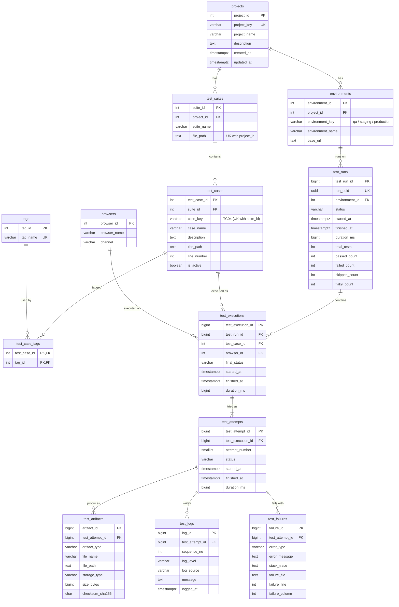

# Qryptive Automation – Database Architecture

PostgreSQL stores every Playwright run in a normalized schema of **13 tables** and **7 reporting views**. The schema is ready for REST APIs and dashboards.

- Schema: [`migrations/001_initial_schema.sql`](migrations/001_initial_schema.sql)
- Views: [`migrations/002_reporting_views.sql`](migrations/002_reporting_views.sql)

---

## 1. ER diagram



The same structure as text:

```text
projects ─┬─< environments ──< test_runs ──< test_executions >── test_cases >── test_suites >── projects
          │                                       │      └──< browsers
          └─< test_suites ──< test_cases ─< test_case_tags >─ tags
                                                  │
                                           test_attempts ─┬─< test_artifacts
                                                          ├─< test_logs
                                                          └─< test_failures
(─< = one-to-many)
```

---

## 2. Tables and relationships

| Table | One row = | Key relationships |
|---|---|---|
| `projects` | An application under test, e.g. `QRYPTIVE` | Parent of environments and suites |
| `environments` | One environment of a project: qa, staging or production, with its base URL | `project_id → projects`. `(project_id, environment_key)` is unique |
| `test_suites` | One spec file, such as `tests/LoginTest.spec.ts`, with its top `describe()` name | `project_id → projects`. `(project_id, file_path)` is unique |
| `test_cases` | One test, such as `TC04 - Login page shows all elements` | `suite_id → test_suites`. `(suite_id, case_key)` is unique |
| `tags` | One tag name, such as `loginpage` | — |
| `test_case_tags` | One test case ↔ tag link (many-to-many) | PK `(test_case_id, tag_id)` |
| `browsers` | One browser and channel combination, e.g. chromium + chrome | `(browser_name, channel)` is unique |
| `test_runs` | One `npx playwright test` command, with its summary counts | `environment_id → environments`. The project comes through the environment |
| `test_executions` | The final result of one test case in one run on one browser | `test_run_id`, `test_case_id` and `browser_id` are FKs. `(run, case, browser)` is unique |
| `test_attempts` | One try: the first run or a retry | `test_execution_id → test_executions`. `(execution, attempt_number)` is unique |
| `test_artifacts` | One stored file: screenshot, trace, video, stdout log, failure log or other | `test_attempt_id → test_attempts` |
| `test_logs` | One stdout or stderr line | `test_attempt_id → test_attempts`. `(attempt, sequence_no)` is unique |
| `test_failures` | One error thrown in an attempt | `test_attempt_id → test_attempts` |
| `schema_migrations` | One applied migration file | Bookkeeping |

**Delete behaviour**
- Deleting a run cascades to its executions, attempts, logs, failures and artifact rows.
- A test case or browser can't be deleted while executions still reference it. Mark the test case `is_active = false` instead.

**Retries**
- Each retry is a new `test_attempts` row with `attempt_number + 1`, so earlier attempts are never overwritten.
- `test_executions.final_status` is the result after the last attempt. It can be `PASSED`, `FAILED`, `SKIPPED`, or `FLAKY`, which means the test failed first and then passed.

**Files**
- Files are stored in `artifacts/<run_uuid>/<case_key>/attempt-<n>/`. Only their path, size, content type and SHA-256 checksum are stored in PostgreSQL.
- `storage_type` (`LOCAL`, `S3`, `AZURE` or `GCS`) lets object storage be added later without changing the schema.

---

## 3. Normalization

**1NF: atomic values, no repeating groups**
- **Tags:** a test can have many tags. They live in `tags` + `test_case_tags`, not in a comma-separated column.
- **Logs:** each log line is its own row in `test_logs`, not one large text block.
- **Errors:** each error in an attempt is a separate `test_failures` row.
- **Artifacts:** a separate `test_artifacts` table holds one row per file. There are no `screenshot_path`, `trace_path` or `video_path` columns.

**2NF: no partial dependency on a composite key**
- The only composite primary key is `test_case_tags(test_case_id, tag_id)`, and it has no other columns.
- Every other table has a single-column surrogate key. Natural keys, such as `(run, case, browser)` or `(execution, attempt_number)`, are enforced with `UNIQUE` constraints instead.
- So no column can depend on only part of a key.

**3NF: no transitive dependency (non-key → non-key)**
- **Project data** is stored only in `projects`. Every other table reaches it through a foreign key.
- **No `project_id` in `test_runs`:** a run's project is decided by its environment, so storing it would create a transitive dependency (run → environment → project).
- **No `file_path` in `test_cases`:** the file path depends on the suite, so it is stored once, in `test_suites`.
- **No environment or browser text on executions:** they are referenced by id.
- **Attempt data is not repeated on the execution:** status, timing and errors stay on `test_attempts`.

**Deliberate exceptions, for reporting speed**
- `test_runs` stores a summary (`total_tests`, `passed_count`, …), written once when the run finishes. Runs never change afterwards, so these counts can't go stale, and run-list dashboards don't need to count rows every time.
- `test_executions.started_at`, `finished_at` and `duration_ms` are rolled up from the attempts each time an attempt is saved.

---

## 4. How a run is saved

`database/DatabaseReporter.ts` is a Playwright reporter registered in `playwright.config.ts`.

| Playwright event | What happens | Transaction |
|---|---|---|
| `onBegin` | Connect to the pool, apply new migrations, upsert the project and environment, insert `test_runs` with status `RUNNING` | Yes |
| `onTestEnd` (each attempt) | Copy the files to `artifacts/`, then upsert the suite, test case, tags and browser. Get or create the execution, then insert the attempt, logs, failures and artifact rows. Finally, update the execution's final status | Yes, one per attempt |
| `onEnd` | Count the executions, then update `test_runs` (status, finish time, summary). Close the pool | — |

**Error handling**
- If the database is down, a warning is printed and the tests still run and report normally.
- If one attempt fails to save, its transaction is rolled back and the others are still saved.

Code layout:

```text
database/
├── db.config.ts                  settings from .env (DB, project, artifact folder)
├── db.connection.ts              connection pool, connectDatabase(), disconnectDatabase(), withTransaction()
├── migrate.ts                    migration runner (schema_migrations + advisory lock + checksums)
├── migrations/                   001_initial_schema.sql, 002_reporting_views.sql
├── types.ts                      shared TypeScript types
├── repositories/                 one class per area; works with the pool or a transaction client
│   ├── CatalogRepository.ts      projects, environments, suites, test cases, tags, browsers
│   ├── TestRunRepository.ts      test_runs
│   ├── TestExecutionRepository.ts
│   ├── TestAttemptRepository.ts
│   ├── EvidenceRepository.ts     logs, failures, artifacts
│   └── ReportRepository.ts       read queries for APIs and dashboards
├── services/TestResultService.ts transactions and business rules
├── storage/ArtifactStorage.ts    copies files to artifacts/ (replaceable with S3 etc.)
├── DatabaseReporter.ts           Playwright → database
└── setup.ts                      command line (npm run db:...)
```

---

## 5. Commands

```bash
npm run db:migrate                 # create the database and apply migrations (also automatic on every test run)
npm run db:runs                    # latest runs with pass rate
npm run db -- run <run_uuid>       # one run and its executions
npm run db:cases                   # test cases with tags and statistics
npm run db -- history TC04         # execution history of one test case
npm run db -- attempts <exec_id>   # retry history of one execution
npm run db:failures                # failure analysis
npm run db:durations               # duration report (min / avg / max / p95)
npm run db:stats                   # pass / fail per day (last 30 days)

RETRIES=1 npx playwright test      # retry failed tests once; each retry is saved as a new attempt
SAVE_RESULTS_TO_DB=false npx playwright test   # run without saving
```

**Adding a schema change:** create `migrations/003_<name>.sql`. It is applied automatically on the next run or `db:migrate`. Never edit a migration that has already been applied.

---

## 6. Sample SQL queries

```sql
-- Latest 10 runs with pass rate
SELECT run_uuid, environment_key, status, started_at, total_tests, passed_count, failed_count, pass_rate
FROM v_test_run_summary WHERE project_key = 'QRYPTIVE'
ORDER BY started_at DESC LIMIT 10;

-- Execution history of one test case
SELECT run_uuid, environment_key, browser_channel, final_status, attempt_count, duration_ms, started_at
FROM v_test_execution_history WHERE project_key = 'QRYPTIVE' AND case_key = 'TC04'
ORDER BY started_at DESC;

-- Flaky tests (failed, then passed on retry)
SELECT case_key, case_name, flaky, total_executions FROM v_test_case_stats
WHERE project_key = 'QRYPTIVE' AND flaky > 0 ORDER BY flaky DESC;

-- Retry history of one execution
SELECT attempt_number, attempt_status, duration_ms FROM v_retry_history
WHERE test_execution_id = 13 ORDER BY attempt_number;

-- Screenshots of failed tests in the last run
SELECT case_key, attempt_number, file_path FROM v_artifacts
WHERE artifact_type = 'SCREENSHOT'
  AND run_uuid = (SELECT run_uuid FROM test_runs ORDER BY started_at DESC LIMIT 1);

-- Logs of one attempt (only errors)
SELECT sequence_no, log_level, message, logged_at FROM test_logs
WHERE test_attempt_id = 12 AND log_level = 'ERROR' ORDER BY sequence_no;

-- Most frequent failures in the last 7 days
SELECT f.error_type, SPLIT_PART(f.error_message, E'\n', 1) AS error, COUNT(*) AS times
FROM test_failures f WHERE f.created_at >= now() - interval '7 days'
GROUP BY 1, 2 ORDER BY times DESC LIMIT 10;

-- Pass / fail per environment
SELECT environment_key, COUNT(*) AS runs, ROUND(AVG(pass_rate), 2) AS avg_pass_rate
FROM v_test_run_summary WHERE project_key = 'QRYPTIVE' GROUP BY environment_key;

-- Slowest test cases (95th percentile of passed attempts)
SELECT case_key, case_name, avg_ms, p95_ms FROM v_duration_report
WHERE project_key = 'QRYPTIVE' ORDER BY p95_ms DESC LIMIT 5;
```

---

## 7. Future REST API

Each `ReportRepository` method already matches one endpoint. An Express or NestJS API only needs to call the method and return its rows as JSON.

| Endpoint | Repository method | View / table |
|---|---|---|
| `GET /projects` | `listProjects()` | `projects` |
| `GET /projects/:key/environments` | `listEnvironments()` | `environments` |
| `GET /projects/:key/test-cases` | `listTestCases()` | `v_test_case_stats` |
| `GET /projects/:key/runs` | `getRunHistory()` | `v_test_run_summary` |
| `GET /runs/:runUuid` | `getRunDetails()` | `v_test_run_summary` + `v_test_execution_history` |
| `GET /projects/:key/test-cases/:caseKey/history` | `getTestCaseHistory()` | `v_test_execution_history` |
| `GET /executions/:id/attempts` | `getRetryHistory()` | `v_retry_history` |
| `GET /executions/:id/artifacts?type=SCREENSHOT` | `getArtifacts()` | `v_artifacts` |
| `GET /attempts/:id/logs?level=ERROR` | `getLogs()` | `test_logs` |
| `GET /attempts/:id/failures` | `getFailures()` | `test_failures` |
| `GET /projects/:key/failures` | `getFailureAnalysis()` | `v_failure_analysis` |
| `GET /projects/:key/durations` | `getDurationReport()` | `v_duration_report` |
| `GET /projects/:key/stats?days=30` | `getDailyStats()` | `v_test_execution_history` |

Sample responses:

```jsonc
// GET /projects/QRYPTIVE/runs?limit=1
{
  "data": [{
    "runUuid": "2b9e34b4-432b-4796-aa00-6f3713aebe5f",
    "environment": { "key": "qa", "name": "QA", "baseUrl": "https://app.qryptive.ai" },
    "status": "FAILED",
    "startedAt": "2026-11-13T10:01:42.000Z",
    "finishedAt": "2026-11-13T10:03:16.000Z",
    "durationMs": 94338,
    "summary": { "total": 12, "passed": 11, "failed": 1, "skipped": 0, "flaky": 0, "passRate": 91.67 }
  }],
  "page": { "limit": 1, "offset": 0 }
}

// GET /runs/2b9e34b4-432b-4796-aa00-6f3713aebe5f
{
  "runUuid": "2b9e34b4-432b-4796-aa00-6f3713aebe5f",
  "status": "FAILED",
  "summary": { "total": 12, "passed": 11, "failed": 1, "skipped": 0, "flaky": 0, "passRate": 91.67 },
  "executions": [
    { "executionId": 12, "caseKey": "TC14", "caseName": "Intentional failure to check screenshot in report",
      "suite": "Qryptive Login", "filePath": "tests/LoginTest.spec.ts",
      "browser": { "name": "chromium", "channel": "chrome" },
      "finalStatus": "FAILED", "attemptCount": 2, "durationMs": 19333 }
  ]
}

// GET /executions/12/attempts
{
  "executionId": 12,
  "caseKey": "TC14",
  "finalStatus": "FAILED",
  "attempts": [
    { "attemptId": 12, "attemptNumber": 1, "status": "FAILED", "durationMs": 9483,
      "failures": [{ "errorType": "AssertionError",
                     "message": "Error: expect(locator).toBeVisible() failed",
                     "location": { "file": "tests/LoginTest.spec.ts", "line": 99, "column": 87 } }],
      "artifacts": [
        { "type": "SCREENSHOT", "fileName": "test-failed-1.png",
          "url": "/files/artifacts/2b9e34b4-.../TC14/attempt-1/test-failed-1.png" },
        { "type": "TRACE", "fileName": "trace.zip", "url": "/files/artifacts/2b9e34b4-.../TC14/attempt-1/trace.zip" }
      ] },
    { "attemptId": 13, "attemptNumber": 2, "status": "FAILED", "durationMs": 9850 }
  ]
}

// GET /projects/QRYPTIVE/test-cases
{
  "data": [{
    "caseKey": "TC04", "caseName": "Login page shows all elements", "suite": "Qryptive Login",
    "filePath": "tests/LoginTest.spec.ts", "tags": ["loginpage"], "isActive": true,
    "stats": { "executions": 2, "passed": 2, "failed": 0, "flaky": 0, "passRate": 100, "avgDurationMs": 4004,
               "lastStatus": "PASSED", "lastExecutedAt": "2026-11-13T10:03:38.000Z" }
  }]
}

// GET /attempts/12/logs
{ "attemptId": 12, "logs": [
  { "seq": 1, "level": "INFO", "source": "STDOUT", "message": "Opening login page", "at": "2026-11-13T10:02:55.900Z" },
  { "seq": 2, "level": "INFO", "source": "STDOUT", "message": "Login page elements are visible", "at": "2026-11-13T10:02:59.100Z" }
]}
```

---

## 8. How a future UI dashboard uses this

| Dashboard screen | Data source |
|---|---|
| Home: KPI tiles (last run status, pass rate, failed, flaky) | `GET /projects/:key/runs?limit=1` (`v_test_run_summary`) |
| Pass/fail trend chart | `GET /projects/:key/stats?days=30` |
| Run list → run detail page | `GET /projects/:key/runs`, then `GET /runs/:uuid` |
| Test case catalogue (filter by tag or suite) | `GET /projects/:key/test-cases` (`v_test_case_stats`) |
| Test case page (history timeline, flaky badge) | `GET /projects/:key/test-cases/:caseKey/history` |
| Execution detail: attempt tabs | `GET /executions/:id/attempts` |
| Screenshot gallery, video player, trace download | `GET /executions/:id/artifacts?type=...`; the API serves `file_path` from `ARTIFACT_DIR` (or a signed S3 URL) |
| Log viewer with level filter | `GET /attempts/:id/logs?level=ERROR` |
| Failure analysis (top errors, affected runs) | `GET /projects/:key/failures` (`v_failure_analysis`) |
| Performance (slowest tests, p95) | `GET /projects/:key/durations` (`v_duration_report`) |

**Adding another Qryptive module** (e.g. Certificates) needs no schema change:
1. Add its spec file.
2. On the first run, a new `test_suites` row is created automatically.
3. Its test cases, tags and history follow the same structure.

**Adding another project:** set `PROJECT_KEY` and `PROJECT_NAME` in `.env`.
